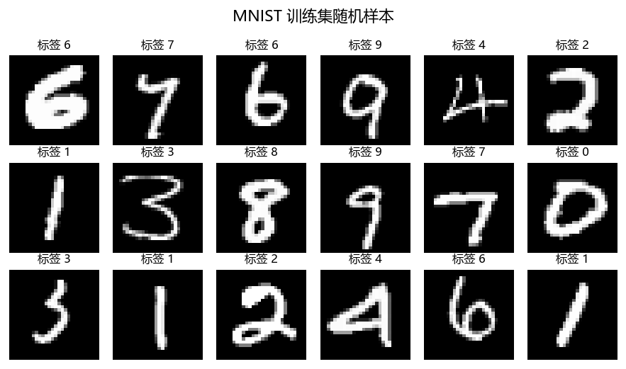

# 第 1 章 数据加载：把原材料搬进流水线

## 本章要解决什么问题

模型再漂亮，也是吃数据长大的。这一章不训练任何东西，只回答四个问题：

1. MNIST 到底是什么样的数据，有多少张、长什么形状？
2. PyTorch 里 `Dataset` 和 `DataLoader` 各自负责什么？
3. `ToTensor()` 和 `Normalize()` 这两个几乎每份代码都会出现的操作，具体把数据改成了什么样？
4. 训练集 / 验证集 / 测试集为什么要这么切？

这四个问题答不上来，后面所有章节都会变成"照抄代码"。反过来，这一章弄明白了，你会发现后面七章里数据部分**一行都不用改**。

---

## 1.1 MNIST 长什么样

MNIST 是一个手写数字数据集，可以理解成"深度学习的 Hello World"。它的规模小到普通笔记本几秒钟就能跑完一轮，又足够真实（是真正的手写笔迹，不是人造数据），所以被用来验证各种想法。

本章脚本实测得到的事实（完整输出见 `results/ch01_stats_full.txt`）：

| 项 | 值 |
|---|---|
| 训练集总数 | 60000 |
| 测试集总数 | 10000 |
| 图像尺寸 | 28 × 28 像素 |
| 通道数 | 1（灰度图，不是彩色） |
| 类别数 | 10（数字 0–9） |
| 单张张量形状 | `(1, 28, 28)`，`float32` |
| 一个 batch 的形状 | `(128, 1, 28, 28)` |

把它随机抽 18 张画出来是这样：



*图 1-1：MNIST 训练集随机样本，每张图上方是它的真实标签*

注意每张小图上方标的是**标签**（这张图真实代表哪个数字），不是模型的预测。这是监督学习的基本设定：我们手里有一堆"图片 + 正确答案"的配对，让模型学着从图片推出答案。

<blockquote class="tip">

**💡 提示**

图里有些数字写得很潦草（比如第二行最右边那个"0"是歪的，第三行第三个"2"连笔了）。
这正是 MNIST 的价值 —— 如果每张图都写得像打印体，识别就太简单了，
也测不出模型的真实水平。**数据集里的"噪声"才是模型要学的难点。**

</blockquote>

---

## 1.2 `Dataset` 和 `DataLoader` 各解决什么

初学时常把这两个搞混。一句话区分：

- **`Dataset`：管"怎么取第 i 个样本"。** 它回答"一共有多少条数据"和"第 i 条是什么样"。
- **`DataLoader`：管"怎么成批取、按什么顺序取、用几个进程取"。** 它把 `Dataset` 包起来，负责批量、打乱、并行。

为什么非要分成两层？因为这样分工之后，**换数据集只需要换 `Dataset`，换批量策略只需要换 `DataLoader`**，两者互不干扰。你自己写数据集（比如读取自己的图片文件夹）时，只需要实现 `__len__` 和 `__getitem__` 两个方法，批量、打乱这些脏活 `DataLoader` 全包了。

```python
class MyDataset(Dataset):
    def __len__(self):            # 一共多少条
        return len(self.items)

    def __getitem__(self, i):     # 第 i 条长什么样
        img = load_image(self.items[i])
        return img, label
```

MNIST 是内置数据集，`torchvision.datasets.MNIST` 已经帮你写好了这两个方法，还带自动下载。

---

## 1.3 逐行读 `ch01_data.py`

本章脚本在 `code/ch01_data.py`。前面三个函数（`parse_args` / `set_seed` / `get_device`）和第 0 章完全一样，每个章节都自带一份，为的是**每个脚本都能单独运行**，不用管别的文件。这里只看新的部分。

### 第一步：定义处理流水线

```python
MNIST_MEAN, MNIST_STD = 0.1307, 0.3081

def build_transform(normalize=True):
    steps = [transforms.ToTensor()]
    if normalize:
        steps.append(transforms.Normalize((MNIST_MEAN,), (MNIST_STD,)))
    return transforms.Compose(steps)
```

`transforms.Compose` 就是个"流水线"：数据依次经过列表里的每一步。这里两步，下面分别讲。

注意 `normalize=False` 这个开关存在的原因 —— **画图的时候必须关掉归一化**，理由见 1.5 节。

### 第二步：加载数据集

```python
datasets.MNIST(str(DATA), train=train, download=True, transform=transform)
```

四个参数：

| 参数 | 作用 |
|---|---|
| 第一个位置参数 | 数据存到哪个目录。本章是 `<ROOT>/data`。**换项目时这里一定要改**，否则数据会散落在各处 |
| `train` | `True` 取 60000 张训练集，`False` 取 10000 张测试集 |
| `download` | 本地没有就自动下载。已经有了则直接读，**不会重复下载**（实测确认过） |
| `transform` | 取出第 i 条时自动套用的处理流水线 |

`download=True` 很方便，但在国内网络下它也是本章最大的坑，见 1.7 节。

### 第三步：切分训练集和验证集

```python
g = torch.Generator().manual_seed(seed)
n_train = len(full_train) - N_VAL          # 60000 - 10000 = 50000
train_set, val_set = random_split(full_train, [n_train, N_VAL], generator=g)
```

`random_split` 把 60000 张按 `[50000, 10000]` 的比例切成两份。

**`generator=g` 这个参数不是可有可无的。** 不传的话每次运行切出来的数据都不一样，你的实验结果就没法复现了 —— 换个种子，准确率变了，你分不清是模型改动带来的还是切分不同带来的。传了固定种子的 generator，每次切出来的就是同一批数据。

### 第四步：包装成 DataLoader

```python
train_loader = DataLoader(
    train_set, batch_size=batch_size,
    shuffle=True,        # 训练集打乱
    generator=g,
    num_workers=0,
)
val_loader = DataLoader(val_set, batch_size=batch_size, shuffle=False, num_workers=0)
```

四个关键参数，逐个说清楚：

**`batch_size`** —— 一次喂给模型多少张图。这是**最重要的超参数之一**，直接写进第 5 章要调的东西。本次设为 128，得到：

```
训练集批次数 : 391      (50000 / 128 向上取整)
验证集批次数 : 79       (10000 / 128 向上取整)
测试集批次数 : 79
```

- **太小**（比如 8）：每步看到的信息太少，梯度噪声大，训练震荡；而且 GPU 并行度利用不足，速度反而慢。
- **太大**（比如 4096）：一次要算的梯度太多，显存吃紧；而且每一步的"方向"过于平滑，容易卡在不好的地方，泛化反而变差。
- **典型取值**：64 / 128 / 256。128 是比较稳的起点。

<blockquote class="tip">

**💡 提示**

注意 50000 / 128 = 390.625，但批次数是 391 —— 最后一个 batch 只有 128×391 − 50000 = 48 张。
**DataLoader 默认不会丢掉这不满的一批**（除非你显式设置 `drop_last=True`）。
所以你的模型偶尔会收到一个 shape 是 `(48, 1, 28, 28)` 的 batch。
这也是为什么模型里**不能写死 batch 维度的大小** —— 一旦写死，最后一批就崩。

</blockquote>

**`shuffle`** —— 是否打乱顺序。

训练集必须 `True`。想象一下：如果数据是按标签排好序的（前 6000 张全是 0，接着全是 1……），那么每个 batch 里都是同一个数字，模型每一步只学到一个类别，梯度方向会来回剧烈摆动，根本训不动。打乱让每个 batch 都是"混合的"，梯度才有代表性。

验证集和测试集设 `False`。因为评估时我们只关心总成绩，跟顺序无关；而且不打乱的话，两次运行的结果完全可比。

**`num_workers`** —— 用几个子进程去读数据。

`0` 表示在主进程里读，**不是"不用"**。默认值就是 0。数据量大、预处理重（比如要在线做复杂的图像变换）时，把它调到 4 或 8，可以让"读下一批数据"和"算当前批梯度"同时进行，显著提速。

本书固定用 `0`，原因见 1.7 节 —— 在 Windows 上多进程有一堆额外要求，而 MNIST 小到根本不需要。

**`pin_memory`** —— 本书没用，但你应该知道它是什么。

默认 `False`。设成 `True` 时，DataLoader 会把数据放进"锁页内存"，从内存拷到 GPU 显存会快一些。用 GPU 训练时可以打开。

本章不开它，是因为 MNIST 太小了：一个 batch 才 128×1×28×28×4 字节 ≈ 400 KB，传输耗时在总时间里可以忽略。**开不开取决于你的瓶颈在数据传输还是计算** —— MNIST 属于后者。

### 第五步：取出一个 batch 看看

```python
xb, yb = next(iter(train_loader))
```

实测结果：

```
一个 batch 的 x : shape=(128, 1, 28, 28)  dtype=torch.float32
一个 batch 的 y : shape=(128,)            dtype=torch.int64
                  取值示例 [3, 3, 4, 0, 6, 4, 1, 6, 0, 5]
```

两个细节：

- `x` 的四个维度是 **(批大小, 通道, 高, 宽)**。第 0 维永远是 batch，这是 PyTorch 的约定。
- `y` 是 `int64`（也就是 `long`），不是浮点数。因为 `CrossEntropyLoss` 要的是**类别编号**，不是 one-hot 向量，也不是概率。这一点第 2 章会再强调。

---

## 1.4 `ToTensor()` 到底做了什么

这个名字起得很含糊，实际上它干了两件事：

**① 把取值从 0–255 缩放到 0.0–1.0。** PIL 读进来的图片是 8 位整数，每个像素 0–255。神经网络不喜欢这个量级，所以除以 255。实测：

```
ToTensor 之后范围 : [0.0000, 1.0000]
```

**② 把维度顺序从 HWC 改成 CHW。** PIL 图片的维度是 (高, 宽, 通道)；PyTorch 要的是 (通道, 高, 宽)。实测：

```
Dataset 取出一张 : shape=(1, 28, 28)
```

MNIST 是灰度图，通道数 1，所以高宽是 28×28、通道在最前面。

<blockquote class="warn">

**⚠️ 常见坑**

**CHW 这个顺序是新手画图翻车的头号原因。**
`plt.imshow()` 要的是 (高, 宽) 或 (高, 宽, 通道)，你给它 (1, 28, 28) 它会直接报
`TypeError: Invalid shape (1, 28, 28) for image data`。

解法是 `img.squeeze(0)` 把那个长度为 1 的通道维压掉，变成 (28, 28)。
本章的 `plot_samples()` 里就是这么写的。彩色图则要用 `img.permute(1, 2, 0)`
把通道挪到最后，因为 matplotlib 不认 CHW。

</blockquote>

---

## 1.5 `Normalize` 那两个数的来历

```python
transforms.Normalize((0.1307,), (0.3081,))
```

这两个数的含义是：**整个 MNIST 训练集所有像素的均值是 0.1307，标准差是 0.3081**（都在 0–1 尺度上统计）。它们是别人预先统计好、写进 PyTorch 官方示例里的常数，你在网上看到的每一份 MNIST 代码用的都是这两个数。

它对每个像素做：

```
新值 = (原值 - 0.1307) / 0.3081
```

代入边界值验证（脚本实测）：

```
0 -> -0.4242      1 -> 2.8215
Normalize 之后范围 : [-0.4242, 2.8215]
```

所以归一化之后，像素值**不再落在 0–1 之间**了，有负数、也有大于 1 的。

**为什么要做这一步？** 为了让输入数据的均值接近 0、标准差接近 1。这样每一层的输入尺度稳定，梯度不会因为输入数值的尺度问题而爆炸或消失，训练更容易收敛。这是深度学习里极其通用的技巧，不止 MNIST 用。

<blockquote class="warn">

**⚠️ 常见坑**

**归一化之后不能用 `imshow` 直接画图。**

因为像素值跑到 [−0.42, 2.82] 了，而 `imshow` 配 `cmap="gray"` 时会把负值当纯黑、
超过 1 的当纯白，画出来是一团糟 —— 要么全黑，要么像底片。

本章 `plot_samples()` 用的是 `build_transform(normalize=False)` 单独加载了一份
没归一化的数据来画图。**这个坑很值钱：以后你自己做可视化时，一定先想清楚
手里这份数据是归一化过的还是没归一化的。**

</blockquote>

还有个小细节值得注意。实测单张图归一化之后的统计是：

```
归一化后均值/标准差 : 0.0227 / 1.0144
```

均值不是正好 0，标准差也不是正好 1。**这不是 bug。** 0.1307 是**整个训练集 60000 张**的平均，不是这一张的平均。单张图的笔画粗细不同、留白多少不同，均值自然会有偏差。归一化是把整个数据集的分布拉到标准正态附近，不是把每一张图各自拉到 0 均值。

---

## 1.6 为什么非要切三份

我们把 60000 张训练集切出 10000 张当验证集，另外 10000 张测试集从头到尾不碰。为什么要这么麻烦？

**训练集**：用来更新权重。模型从它身上学。

**验证集**：训练**过程中**用来做决策 —— 判断有没有过拟合、第几个 epoch 该停、哪组超参数更好。它不参与梯度更新。

**测试集**：全程锁在柜子里，只在最后用**一次**，代表模型面对全新数据的真实水平。

关键在于：**你对验证集做的每一次决策，都是一次"信息泄漏"。**

打个比方。你调了 20 组超参数，在验证集上挑出得分最高的那组。这组之所以得分高，一部分是因为它**真的好**，另一部分是因为它**恰好撞上了这份验证集**。你挑得越多，撞运气的成分越大。这时候如果拿验证集的成绩当最终成绩，就是在自欺欺人 —— 我调了 20 次，总能撞到一个在这份数据上表现好的。

测试集的作用就是给出一个**没有被你的选择污染过**的数字。所以规矩是：**调参只能看验证集，测试集只在最后看一次。** 如果你反复拿测试集调参，那它实际上就变成了验证集，你手里就再也没有能代表真实水平的数字了。

<blockquote class="done">

**📌 结论**

验证集是你"可以反复看"的成绩单，测试集是"只能看一次"的。
判断标准很简单：**只要一个数字影响了你的决策，它就不能再当最终成绩。**

</blockquote>

那 50000/10000 这个比例是怎么定的？经验上验证集占 10%–20% 比较常见。太小（比如 1%），验证成绩波动大，你分不清模型是真变好了还是碰巧；太大（比如 50%），白白浪费了本可以用来训练的数据。MNIST 数据量小，所以本书固定切 10000 张。

<blockquote class="tip">

**💡 提示**

严格的工程做法其实要切**三份**：训练 / 验证 / 测试。
上面我们是从 60000 张训练集里切出验证集，原始那 10000 张测试集始终没动 ——
这正是标准做法，所以本书符合规范。

网上有些教程会直接把测试集当验证集用（一边训练一边在测试集上看准确率），
那是错的，你在那些代码里看到的"准确率 99%"是要打折扣的。

</blockquote>

---

## 1.7 常见坑

<blockquote class="warn">

**⚠️ 常见坑 1：下载卡住不动**

这是本书实际踩到的。`download=True` 时脚本卡了整整 10 分钟没有任何输出，
最后只下到一半。原因是 torchvision 会依次尝试几个下载源
（`ossci-datasets.s3.amazonaws.com` 和 `download.pytorch.org`），
后者在国内**直接返回 403**，而它的失败重试有很长的超时。

**解法：手动下载，跳过 `download` 那一步。**

本章脚本在下载失败时会直接打出可照做的指引。你也可以主动提前下好 ——
用 curl 比 torchvision 自己的下载器快得多（实测 9.9 MB 的文件 14 秒下完，
而 torchvision 10 分钟都没搞定）。四个文件放进 `data/MNIST/raw/`：

```bash
cd "D:/Learning/Pytorch/MNIST_CNN/data/MNIST/raw"
BASE="https://ossci-datasets.s3.amazonaws.com/mnist"
for f in train-images-idx3-ubyte.gz train-labels-idx1-ubyte.gz \
         t10k-images-idx3-ubyte.gz  t10k-labels-idx1-ubyte.gz; do
  curl -L -O "$BASE/$f"
done
```

两个要点：**不要解压**（torchvision 要的就是 `.gz` 原文件）；
目录必须是 `data/MNIST/raw/`，放错地方它照样会去下载。

</blockquote>

<br>

> **⚠️ 常见坑 2：`num_workers` 在 Windows 上炸**
>
> 在 Linux 上把 `num_workers` 设成 4 是常规操作，在 Windows 上照抄经常会遇到：
>
> - 报 `RuntimeError: DataLoader worker (pid xxx) is killed by signal` 
> - 或者整个脚本反复重启，卡在 `if __name__ == "__main__":` 那行前面
> - 或者内存爆掉（每个子进程都会复制一份数据）
>
> 根源是 Windows 用 `spawn` 而不是 `fork` 创建子进程：子进程会**重新导入一遍你的模块**，
> 所以你的数据加载代码只要不是写在 `if __name__ == "__main__":` 保护里，就会被子进程
> 再执行一遍，无限递归。
>
> **本书的处理方式：全部用 `num_workers=0`。** MNIST 太小了，多进程带来的收益接近零，
> 而踩坑的成本很高。等你以后处理大得多的数据集时再回头调它 —— 那时也记得务必把
> 主流程放进 `if __name__ == "__main__":` 里。

<br>

> **⚠️ 常见坑 3：图里的中文变成方块**
>
> 本书实测遇到：matplotlib 默认字体是 DejaVu Sans，**不含中文字形**，
> 图上所有中文会显示成 `□□□`，还会刷一屏 `UserWarning: Glyph 38598 ... missing from font(s)`。
>
> 解法是在画图前指定中文字体：
>
> ```python
> import matplotlib
> matplotlib.rcParams["font.sans-serif"] = [
>     "Microsoft YaHei", "SimHei", "Noto Sans CJK SC", "DejaVu Sans",
> ]
> matplotlib.rcParams["axes.unicode_minus"] = False   # 负号也要处理，否则坐标轴负号同样是方块
> ```
>
> 列表里可以写多个，matplotlib 会自动选第一个装了的。

<br>

> **⚠️ 常见坑 4：`OSError: [Errno 22] Invalid argument` 保存图片失败**
>
> 本书实测遇到。脚本辛辛苦苦跑完，倒在最后一步 `savefig` 上，报错信息完全看不出原因。
>
> 真实原因是**文件被别的进程短暂独占**了 —— Windows 上杀毒软件会扫描新建的文件，
> 资源管理器的预览窗格、你刚打开过的看图软件也可能占着它。此时 `open()` 就会失败。
>
> 本章的 `_savefig()` 做了一件事：失败就等 1 秒重试，最多 5 次。
> 这类占用通常一两秒内就消失了。**这不是 MNIST 特有的问题**，你以后写任何
> 会产出文件的长脚本都值得加这个保护，毕竟前面几分钟的计算不该白费。

---

## 小结

- `Dataset` 管"怎么取第 i 条"，`DataLoader` 管"怎么批量取、打乱、并行"
- `ToTensor()` = 数值缩放到 0–1 **+** 维度从 HWC 改成 CHW
- `Normalize((0.1307,), (0.3081,))` 对每个像素做 `(x − 0.1307) / 0.3081`，之后像素值不再在 0–1 之间，**不能直接 `imshow`**
- `batch_size` 是最重要的超参数之一，本书用 128；最后一批可能不满，所以模型里不能写死 batch 维度
- `shuffle=True` 只给训练集；`num_workers=0` 在 Windows 上最稳
- 训练集学参数，验证集做决策，测试集只在最后看一次 —— **凡是影响过你决策的数字，都不能再当最终成绩**
- 本章脚本产出的真实数字都在 `results/ch01_stats_full.txt`，这是后面各章的基准

## 练习

**练习 1（必做）** 运行 `python code/ch01_data.py`，对照 `results/ch01_stats_full.txt` 确认输出一致。特别是 `一个 batch 的 x : shape=(128, 1, 28, 28)` 这一行。

**练习 2（理解题）** 把 `--batch-size` 改成 100，预测批次数会变成多少？先自己算，再运行验证。
*提示：50000 / 100 整除，但 10000 / 100 也整除 —— 想想看，这次还有"不满的最后一批"吗？*

**练习 3（动手）** 把 `build_transform(normalize=True)` 改成 `False`，运行后观察：
- `Normalize 之后范围` 那一行会变成什么？
- 后面第 3 节的 `一个 batch x 的范围` 会变成什么？

*观察什么：这能让你亲眼看到归一化到底改变了什么。*

**练习 4（踩坑体验）** 把 `plot_samples()` 里的 `build_transform(normalize=False)` 改成 `normalize=True`，重新生成 `figures/ch01_samples.png`，打开图看看变成什么样。

*观察什么：亲手看一次"归一化后画图"的后果，比读十遍警告都记得牢。看完记得改回去。*

**练习 5（选做）** 把 `N_VAL` 从 10000 改成 1000，观察批次数变化。想一想：验证集变小了，会带来什么坏处？

*观察什么：这就是 1.6 节说的"验证集太小，成绩波动大"的具体来源。*
